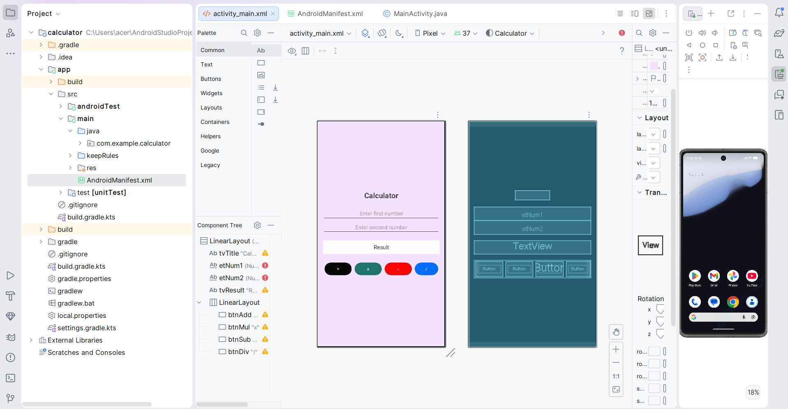

# Calculator-App
# Ex.No:5 Develop a simple calculator using android studio.

## AIM:

To develop a program to develop a simple calculator in Android Studio.

## EQUIPMENTS REQUIRED:

Android Studio(Min.required Artic Fox)

## ALGORITHM:

Step 1: Open Android Stdio and then click on File -> New -> New project.

Step 2: Then type the Application name as calculator and click Next. 

Step 3: Then select the Minimum SDK as shown below and click Next.

Step 4: Then select the Empty Activity and click Next. Finally click Finish.

Step 5: Design layout using UI components in activity_main.xml.

Step 6: Display the calculator operation in MainActivity file.

Step 7: Save and run the application.

### PROGRAM:
```
/*
Program 
Developed by: Karthik J
Registeration Number : 212225040176
*/
```

## Res -> drawable ->
**button_pressed.xml**
```xml
<?xml version="1.0" encoding="utf-8"?>
<selector xmlns:android="http://schemas.android.com/apk/res/android">

    <item android:state_pressed="true">
        <shape>
            <solid android:color="#FFD6B5"/>
            <corners android:radius="28dp"/>
        </shape>
    </item>

    <item>
        <shape>
            <solid android:color="#FFF0E5"/>
            <corners android:radius="28dp"/>
        </shape>
    </item>

</selector>
```
**number_button.xml**
```xml
<?xml version="1.0" encoding="utf-8"?>
<shape xmlns:android="http://schemas.android.com/apk/res/android">
    <solid android:color="#FFF0E5"/>
    <corners android:radius="28dp"/>
    <stroke
        android:width="1dp"
        android:color="#FFE0CC"/>
</shape>
```
**orange_buttton.xml**
```
<?xml version="1.0" encoding="utf-8"?>
<shape xmlns:android="http://schemas.android.com/apk/res/android">
    <solid android:color="#FF8800"/>
    <corners android:radius="28dp"/>
</shape>
```
**special_button.xml**
```
<shape xmlns:android="http://schemas.android.com/apk/res/android">
    <solid android:color="#FFF0E5"/>
    <corners android:radius="28dp"/>
    <stroke android:width="1dp" android:color="#FFE0CC"/>
</shape>
```
## MainActivity.java
```java

package com.example.calculatorapp;

import android.os.Bundle;
import android.view.View;
import android.widget.Button;
import android.widget.TextView;

import androidx.appcompat.app.AppCompatActivity;

import java.math.BigDecimal;

public class MainActivity extends AppCompatActivity {

    TextView tvDisplay, tvHistory;

    double firstNumber = 0;
    double lastSecondNumber = 0;

    String operator = "";
    String lastOperator = "";

    boolean newNumber = true;
    boolean error = false;

    @Override
    protected void onCreate(Bundle savedInstanceState) {
        super.onCreate(savedInstanceState);
        setContentView(R.layout.activity_main);

        // Connect display
        tvDisplay = findViewById(R.id.tvDisplay);
        tvHistory = findViewById(R.id.tvHistory);

        // Number buttons
        int[] numberButtonIds = {
                R.id.btn0, R.id.btn1, R.id.btn2,
                R.id.btn3, R.id.btn4, R.id.btn5,
                R.id.btn6, R.id.btn7, R.id.btn8, R.id.btn9
        };

        for (int id : numberButtonIds) {
            Button button = findViewById(id);
            button.setOnClickListener(this::numberClick);
        }

        // Decimal button
        findViewById(R.id.btnDot).setOnClickListener(this::numberClick);

        // Double zero
        findViewById(R.id.btn00).setOnClickListener(v -> doubleZeroClick());

        // Arithmetic operators
        findViewById(R.id.btnAdd).setOnClickListener(v -> operatorClick("+"));
        findViewById(R.id.btnSubtract).setOnClickListener(v -> operatorClick("-"));
        findViewById(R.id.btnMultiply).setOnClickListener(v -> operatorClick("×"));
        findViewById(R.id.btnDivide).setOnClickListener(v -> operatorClick("÷"));

        // Equals
        findViewById(R.id.btnEquals).setOnClickListener(v -> calculate());

        // Clear
        findViewById(R.id.btnClear).setOnClickListener(v -> clear());

        // Backspace
        findViewById(R.id.btnBack).setOnClickListener(v -> backspaceClick());

        // Sign toggle
        findViewById(R.id.btnSign).setOnClickListener(v -> signClick());
    }

    // Number and decimal input
    void numberClick(View view) {

        if (error) {
            clear();
        }

        Button button = (Button) view;
        String input = button.getText().toString();
        String current = tvDisplay.getText().toString();

        if (newNumber) {

            if (input.equals(".")) {
                tvDisplay.setText("0.");
            } else {
                tvDisplay.setText(input);
            }

            newNumber = false;

        } else {

            if (input.equals(".")) {

                if (!current.contains(".")) {
                    tvDisplay.setText(current + ".");
                }

            } else {

                if (current.equals("0")) {
                    tvDisplay.setText(input);
                } else if (current.equals("-0")) {
                    tvDisplay.setText("-" + input);
                } else {
                    tvDisplay.setText(current + input);
                }
            }
        }

        // Update expression while typing
        updateExpression();
    }

    // Double zero button
    void doubleZeroClick() {

        if (error) {
            clear();
        }

        String current = tvDisplay.getText().toString();

        if (newNumber) {
            tvDisplay.setText("0");
            newNumber = false;
        } else if (current.equals("0")) {
            tvDisplay.setText("0");
        } else if (current.equals("-0")) {
            tvDisplay.setText("-0");
        } else {
            tvDisplay.setText(current + "00");
        }

        updateExpression();
    }

    // Operator handling
    void operatorClick(String op) {

        if (error) {
            clear();
            return;
        }

        double currentValue = getDisplayValue();

        // Calculate chained operations
        if (!operator.isEmpty() && !newNumber) {

            double result = performCalculation(
                    firstNumber,
                    currentValue,
                    operator
            );

            if (Double.isNaN(result) || Double.isInfinite(result)) {
                showError();
                return;
            }

            tvDisplay.setText(formatResult(result));
            firstNumber = result;

        } else {

            firstNumber = currentValue;
        }

        operator = op;
        newNumber = true;

        // Display expression
        tvHistory.setText(formatResult(firstNumber) + " " + operator);
    }

    // Update expression preview
    void updateExpression() {

        if (!operator.isEmpty()) {

            tvHistory.setText(
                    formatResult(firstNumber) + " " +
                            operator + " " +
                            tvDisplay.getText().toString()
            );
        }
    }

    // Calculate result
    void calculate() {

        if (error) {
            return;
        }

        // Normal calculation
        if (!operator.isEmpty()) {

            double secondNumber = getDisplayValue();

            double result = performCalculation(
                    firstNumber,
                    secondNumber,
                    operator
            );

            if (Double.isNaN(result) || Double.isInfinite(result)) {
                showError();
                return;
            }

            // Show complete expression
            tvHistory.setText(
                    formatResult(firstNumber) + " " +
                            operator + " " +
                            formatResult(secondNumber) + " ="
            );

            // Save for repeated equals
            lastOperator = operator;
            lastSecondNumber = secondNumber;

            tvDisplay.setText(formatResult(result));

            firstNumber = result;
            operator = "";
            newNumber = true;
        }

        // Repeated equals
        else if (!lastOperator.isEmpty() && newNumber) {

            double current = getDisplayValue();

            double result = performCalculation(
                    current,
                    lastSecondNumber,
                    lastOperator
            );

            if (Double.isNaN(result) || Double.isInfinite(result)) {
                showError();
                return;
            }

            tvHistory.setText(
                    formatResult(current) + " " +
                            lastOperator + " " +
                            formatResult(lastSecondNumber) + " ="
            );

            tvDisplay.setText(formatResult(result));

            firstNumber = result;
            newNumber = true;
        }
    }

    // Mathematical operations
    double performCalculation(double a, double b, String op) {

        switch (op) {

            case "+":
                return a + b;

            case "-":
                return a - b;

            case "×":
                return a * b;

            case "÷":
                if (b == 0) {
                    return Double.NaN;
                }
                return a / b;

            default:
                return b;
        }
    }

    // Clear calculator
    void clear() {

        tvDisplay.setText("0");
        tvHistory.setText("");

        firstNumber = 0;
        lastSecondNumber = 0;

        operator = "";
        lastOperator = "";

        newNumber = true;
        error = false;
    }

    // Backspace
    void backspaceClick() {

        if (error) {
            clear();
            return;
        }

        if (newNumber) {
            tvDisplay.setText("0");
            newNumber = false;
            updateExpression();
            return;
        }

        String current = tvDisplay.getText().toString();

        if (current.length() > 1) {

            current = current.substring(0, current.length() - 1);

            if (current.equals("-") || current.isEmpty()) {
                current = "0";
            }

        } else {
            current = "0";
        }

        tvDisplay.setText(current);
        updateExpression();
    }

    // Positive / Negative sign
    void signClick() {

        if (error) {
            clear();
            return;
        }

        double value = getDisplayValue();

        if (value == 0) {
            return;
        }

        if (value > 0) {
            tvDisplay.setText("-" + formatResult(value));
        } else {
            tvDisplay.setText(formatResult(Math.abs(value)));
        }

        newNumber = false;
        updateExpression();
    }

    // Get number from display
    double getDisplayValue() {

        String value = tvDisplay.getText().toString();

        if (value.isEmpty() || value.equals("-") || value.equals(".")) {
            return 0;
        }

        try {
            return Double.parseDouble(value);
        } catch (NumberFormatException e) {
            return 0;
        }
    }

    // Format numbers
    String formatResult(double value) {

        return BigDecimal.valueOf(value)
                .stripTrailingZeros()
                .toPlainString();
    }

    // Error handling
    void showError() {

        tvHistory.setText("");
        tvDisplay.setText("Cannot divide by 0");

        operator = "";
        lastOperator = "";

        firstNumber = 0;
        lastSecondNumber = 0;

        newNumber = true;
        error = true;
    }
}
```

## activity_main.xml
```xml
<?xml version="1.0" encoding="utf-8"?>
<LinearLayout xmlns:android="http://schemas.android.com/apk/res/android"
    android:layout_width="match_parent"
    android:layout_height="match_parent"
    android:orientation="vertical"
    android:background="#FFFFFF"
    android:padding="10dp">

    <!-- Display Screen -->
    <LinearLayout
        android:layout_width="match_parent"
        android:layout_height="0dp"
        android:layout_weight="2.2"
        android:orientation="vertical"
        android:gravity="bottom"
        android:padding="16dp">

        <TextView
            android:id="@+id/tvHistory"
            android:layout_width="match_parent"
            android:layout_height="wrap_content"
            android:gravity="end"
            android:text=""
            android:textColor="#999999"
            android:textSize="24sp"
            android:paddingBottom="12dp"/>

        <TextView
            android:id="@+id/tvDisplay"
            android:layout_width="match_parent"
            android:layout_height="wrap_content"
            android:gravity="end"
            android:text="0"
            android:textColor="#171717"
            android:textSize="56sp"
            android:maxLines="1"
            android:autoSizeTextType="uniform"
            android:autoSizeMinTextSize="28sp"
            android:autoSizeMaxTextSize="56sp"
            android:autoSizeStepGranularity="2sp"/>

    </LinearLayout>

    <!-- Row 1 : Clear, Backspace, Divide, Multiply -->
    <LinearLayout
        android:layout_width="match_parent"
        android:layout_height="0dp"
        android:layout_weight="1"
        android:orientation="horizontal">

        <Button
            android:id="@+id/btnClear"
            android:text="C"
            android:textSize="24sp"
            android:textColor="#FFFFFF"
            android:background="@drawable/orange_button"
            android:backgroundTint="@null"
            android:layout_width="0dp"
            android:layout_height="match_parent"
            android:layout_weight="1"
            android:layout_margin="5dp"/>

        <Button
            android:id="@+id/btnBack"
            android:text="⌫"
            android:textSize="24sp"
            android:textColor="#FFFFFF"
            android:background="@drawable/orange_button"
            android:backgroundTint="@null"
            android:layout_width="0dp"
            android:layout_height="match_parent"
            android:layout_weight="1"
            android:layout_margin="5dp"/>

        <Button
            android:id="@+id/btnDivide"
            android:text="÷"
            android:textSize="26sp"
            android:textColor="#FFFFFF"
            android:background="@drawable/orange_button"
            android:backgroundTint="@null"
            android:layout_width="0dp"
            android:layout_height="match_parent"
            android:layout_weight="1"
            android:layout_margin="5dp"/>

        <Button
            android:id="@+id/btnMultiply"
            android:text="×"
            android:textSize="26sp"
            android:textColor="#FFFFFF"
            android:background="@drawable/orange_button"
            android:backgroundTint="@null"
            android:layout_width="0dp"
            android:layout_height="match_parent"
            android:layout_weight="1"
            android:layout_margin="5dp"/>

    </LinearLayout>

    <!-- Row 2 : 7, 8, 9, Minus -->
    <LinearLayout
        android:layout_width="match_parent"
        android:layout_height="0dp"
        android:layout_weight="1"
        android:orientation="horizontal">

        <Button
            android:id="@+id/btn7"
            android:text="7"
            android:textSize="26sp"
            android:textColor="#222222"
            android:background="@drawable/number_button"
            android:backgroundTint="@null"
            android:layout_width="0dp"
            android:layout_height="match_parent"
            android:layout_weight="1"
            android:layout_margin="5dp"/>

        <Button
            android:id="@+id/btn8"
            android:text="8"
            android:textSize="26sp"
            android:textColor="#222222"
            android:background="@drawable/number_button"
            android:backgroundTint="@null"
            android:layout_width="0dp"
            android:layout_height="match_parent"
            android:layout_weight="1"
            android:layout_margin="5dp"/>

        <Button
            android:id="@+id/btn9"
            android:text="9"
            android:textSize="26sp"
            android:textColor="#222222"
            android:background="@drawable/number_button"
            android:backgroundTint="@null"
            android:layout_width="0dp"
            android:layout_height="match_parent"
            android:layout_weight="1"
            android:layout_margin="5dp"/>

        <Button
            android:id="@+id/btnSubtract"
            android:text="−"
            android:textSize="26sp"
            android:textColor="#FFFFFF"
            android:background="@drawable/orange_button"
            android:backgroundTint="@null"
            android:layout_width="0dp"
            android:layout_height="match_parent"
            android:layout_weight="1"
            android:layout_margin="5dp"/>

    </LinearLayout>

    <!-- Row 3 : 4, 5, 6, Plus -->
    <LinearLayout
        android:layout_width="match_parent"
        android:layout_height="0dp"
        android:layout_weight="1"
        android:orientation="horizontal">

        <Button
            android:id="@+id/btn4"
            android:text="4"
            android:textSize="26sp"
            android:textColor="#222222"
            android:background="@drawable/number_button"
            android:backgroundTint="@null"
            android:layout_width="0dp"
            android:layout_height="match_parent"
            android:layout_weight="1"
            android:layout_margin="5dp"/>

        <Button
            android:id="@+id/btn5"
            android:text="5"
            android:textSize="26sp"
            android:textColor="#222222"
            android:background="@drawable/number_button"
            android:backgroundTint="@null"
            android:layout_width="0dp"
            android:layout_height="match_parent"
            android:layout_weight="1"
            android:layout_margin="5dp"/>

        <Button
            android:id="@+id/btn6"
            android:text="6"
            android:textSize="26sp"
            android:textColor="#222222"
            android:background="@drawable/number_button"
            android:backgroundTint="@null"
            android:layout_width="0dp"
            android:layout_height="match_parent"
            android:layout_weight="1"
            android:layout_margin="5dp"/>

        <Button
            android:id="@+id/btnAdd"
            android:text="+"
            android:textSize="26sp"
            android:textColor="#FFFFFF"
            android:background="@drawable/orange_button"
            android:backgroundTint="@null"
            android:layout_width="0dp"
            android:layout_height="match_parent"
            android:layout_weight="1"
            android:layout_margin="5dp"/>

    </LinearLayout>

    <!-- Row 4 : 1, 2, 3, Equals -->
    <LinearLayout
        android:layout_width="match_parent"
        android:layout_height="0dp"
        android:layout_weight="1"
        android:orientation="horizontal">

        <Button
            android:id="@+id/btn1"
            android:text="1"
            android:textSize="26sp"
            android:textColor="#222222"
            android:background="@drawable/number_button"
            android:backgroundTint="@null"
            android:layout_width="0dp"
            android:layout_height="match_parent"
            android:layout_weight="1"
            android:layout_margin="5dp"/>

        <Button
            android:id="@+id/btn2"
            android:text="2"
            android:textSize="26sp"
            android:textColor="#222222"
            android:background="@drawable/number_button"
            android:backgroundTint="@null"
            android:layout_width="0dp"
            android:layout_height="match_parent"
            android:layout_weight="1"
            android:layout_margin="5dp"/>

        <Button
            android:id="@+id/btn3"
            android:text="3"
            android:textSize="26sp"
            android:textColor="#222222"
            android:background="@drawable/number_button"
            android:backgroundTint="@null"
            android:layout_width="0dp"
            android:layout_height="match_parent"
            android:layout_weight="1"
            android:layout_margin="5dp"/>

        <Button
            android:id="@+id/btnEquals"
            android:layout_width="0dp"
            android:layout_height="match_parent"
            android:layout_margin="5dp"
            android:layout_weight="1"
            android:background="@drawable/orange_button"
            android:backgroundTint="@null"
            android:text="="
            android:textColor="#FFFFFF"
            android:textSize="26sp" />

    </LinearLayout>

    <!-- Row 5 : Sign, Zero, Decimal, Double Zero -->
    <LinearLayout
        android:layout_width="match_parent"
        android:layout_height="0dp"
        android:layout_weight="1"
        android:orientation="horizontal">

        <Button
            android:id="@+id/btnSign"
            android:text="+/−"
            android:textSize="22sp"
            android:textColor="#222222"
            android:background="@drawable/special_button"
            android:backgroundTint="@null"
            android:layout_width="0dp"
            android:layout_height="match_parent"
            android:layout_weight="1"
            android:layout_margin="5dp"/>

        <Button
            android:id="@+id/btn0"
            android:text="0"
            android:textSize="26sp"
            android:textColor="#222222"
            android:background="@drawable/number_button"
            android:backgroundTint="@null"
            android:layout_width="0dp"
            android:layout_height="match_parent"
            android:layout_weight="1"
            android:layout_margin="5dp"/>

        <Button
            android:id="@+id/btnDot"
            android:text="."
            android:textSize="26sp"
            android:textColor="#222222"
            android:background="@drawable/special_button"
            android:backgroundTint="@null"
            android:layout_width="0dp"
            android:layout_height="match_parent"
            android:layout_weight="1"
            android:layout_margin="5dp"/>

        <Button
            android:id="@+id/btn00"
            android:text="00"
            android:textSize="26sp"
            android:textColor="#222222"
            android:background="@drawable/number_button"
            android:backgroundTint="@null"
            android:layout_width="0dp"
            android:layout_height="match_parent"
            android:layout_weight="1"
            android:layout_margin="5dp"/>

    </LinearLayout>

</LinearLayout>
```

## OUTPUT



